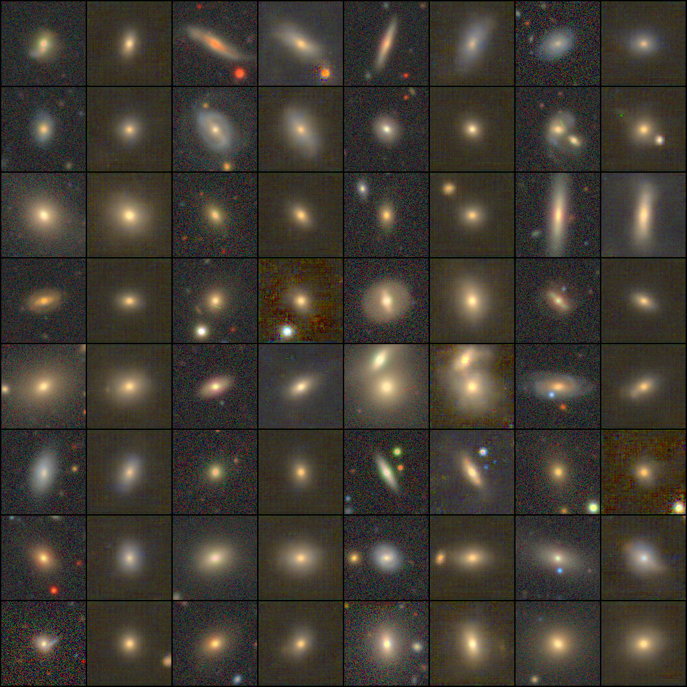
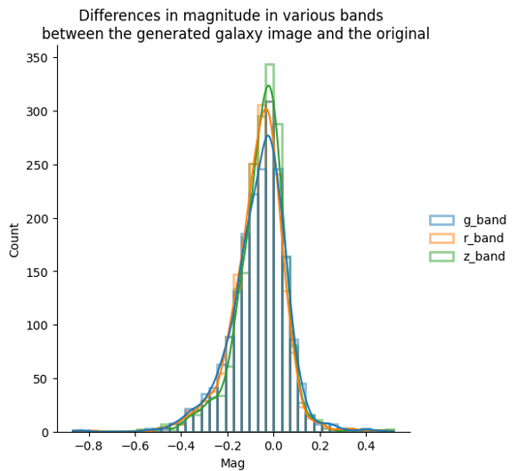
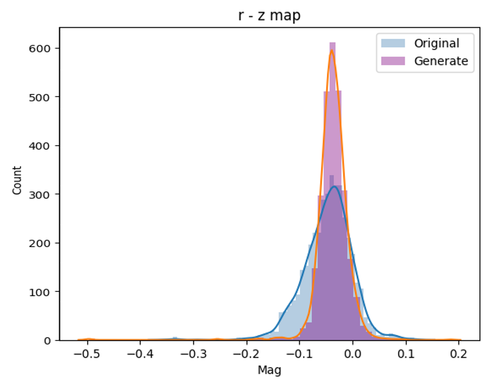
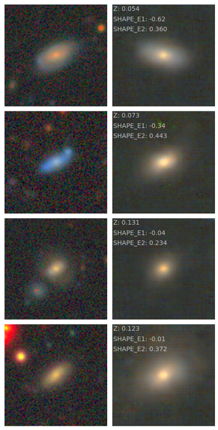
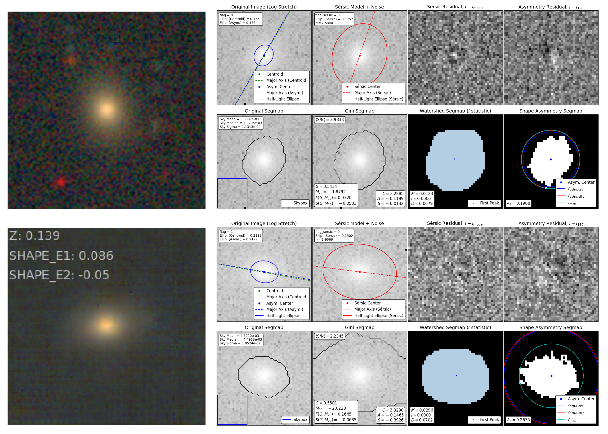

Galaxy_Flow_VAE
========================
English | [简体中文](README_zh.md)

The goal of this work is to combine ``Flow`` and ``VAE`` to build a pipeline capable of generating clean galaxy images from physical parameters and to add to this pipeline the noise of various survey programs and ``PSF`` to provide a closer simulation of galaxy images for the data of various characterization surveys.

The task is divided into two parts: a data-driven unsupervised extraction of morphological features from a large database using ``VAE``; and the construction of a reasonable bijective model between the physical parameters and the extraction of hidden variables by ``Flow``, where the galaxy images are generated using the physical parameters.

This project explores the above methods in various ways, as detailed below.

## Requirements
### Main
-  torch>=1.8.1
-  torchvision>=0.8.0
-  cudatoolkit>=0.7.1
-  itertools
-  nflows

### Minor
-  warnings
-  tensorboard
-  tqdm
-  os
-  h5py
-  astropy
-  matplotlib>=1.0.2
-  argparse
-  datetime
-  random
-  numpy
-  pandas

Details of ``Galaxy_Flow_VAE``
========================

# Part I ``VAE``
## Datasets
This work uses the `DR9` data released by the `DECaLS` project(Selected approximately 230k galaxies with magnitudes less than 17.77 in the 'r' band), and image data of galaxies in the `g, r, z` bands were downloaded from publicly [available websites](https://www.legacysurvey.org/dr9/description/).

The downloaded galaxy image data (image size basically at `1×152×152`, with three bands stacked into a three-channel image), while the physical parameters were obtained by using `sextractor`.

Finally, save the galaxy image and physical parameters to an `h5` file using `create_dataset.ipynb`.

Read the corresponding `h5` file in `my_dataset.py` and crop the `3×182×128` size for training.

## Methods
This work follows the ``VAE`` model of this previous work.
```
@article{10.1093/mnras/stad3181,
    author = {Xu, Quanfeng and Shen, Shiyin and de Souza, Rafael S and Chen, Mi and Ye, Renhao and She, Yumei and Chen, Zhu and Ishida, Emille E O and Krone-Martins, Alberto and Durgesh, Rupesh},
    title = "{From images to features: unbiased morphology classification via variational auto-encoders and domain adaptation}",
    journal = {Monthly Notices of the Royal Astronomical Society},
    volume = {526},
    number = {4},
    pages = {6391-6400},
    year = {2023},
    month = {10},
    issn = {0035-8711},
    doi = {10.1093/mnras/stad3181},
    url = {https://doi.org/10.1093/mnras/stad3181},
}
```
And based on this, a fine-tuning of the model was carried out, in which some ``ReLU`` were modified into ``ELU`` activation functions to make the model predict galaxy images of a more reasonable order of magnitude, instead of the order of magnitude limitations of ``0-255`` or ``0-1`` of the natural images.
### Training
Train the galaxy images in the `h5` file directly with the following commands. (`ssim.py` can calculate the discrepancy between the generated image and the real one.)
```
python train_vae.py
```
The ``--data_path`` parameter needs to be defined.

You can access it by clicking on 
[Github-models](https://github.com/xuquanfeng/Galaxy_Flow_VAE/blob/master/conv_vae.py)
## Result
Use the following command to predict galaxy images, and load the trained `VAE` models for prediction.
```
python predicts_vae.py
```
The visualized results are as follows:



## Result analysis
Use the `sextractor_pipe.ipynb` file for the following parts of the analysis.
Analyses were performed on 256 (batch_size) × 12 (step) images of galaxies randomly selected for magnitude and color.
The first part is a comparison of the magnitudes (physical quantities obtained by using `Sextractor`) of the real galaxy images and the generated galaxy images, and the following figure shows the distribution of the magnitude difference between the three bands of the real and generated images:


The second part is a comparison of the colors of the real galaxy image and the generated galaxy image, and the following figure shows the distribution of the r-z map of the real image and the r-z map of the generated image:


# Part II ``Flow``

A bijection designed to connect physical parameters to vectors of latent variables connects `VAE` and `Flow`.
## Separate Training
- `train_vae.py`: Training code for the first part；
- `predicts_vae.py`: For the above `VAE` model, to predict galaxy images.
- `train_flow.py`: Fastened the `VAE` model that extracted the galaxy morphology after training, then trained `Flow` for mapping.
- `predicts_flow.py`: Loading `VAE` and `Flow` models to predict galaxy images.
## Parallel Training
- `train_flow_vae.py`: Train both `VAE` and `Flow` models in parallel, use the encoder to obtain the latent variables instead of using the latent variables generated by `Flow` to decode the galaxy images to reconstruct the loss from the original, and get the result of optimizing the dynamics of the two models to each other.
- `train_FlowVAE.py`: Train both `VAE` and `Flow` models in parallel, use `Flow` generated latent variables to decode the galaxy image to reconstruct the loss from the original image, and get the result that the two models optimize each other dynamically.
- `predicts_flow.py`: Loading `VAE` and `Flow` models to predict galaxy images.
## Result
Use the following command to predict galaxy images, and load the trained `VAE` and `Flow` models for prediction. (The following images were reconstructed using only three morphological parameters, namely `Z,SHAPE_E1,SHAPE_E2`, without considering the physical rotation angle.)
```
python predicts_flow.py
```
The visualized results are as follows:



## Result analysis
Use the `anaylize_flowvae.ipynb` file for the following parts of the analysis.
We randomly selected a galaxy image to use `statmorph` for morphological statistics.

In this result, the `FlowVAE` program is not like the `VAE` program that can directly obtain similar morphology one-to-one, but this aptly explains the results generated by our experiments using only the three-parameter reconstruction of `Z, SHAPE_E1, and SHAPE_E2` (only the inward ellipticity is given, and not the rotation angle).

# Citation
If you'd like to cite this work, please use the following.
```
Waiting accepted.
```
